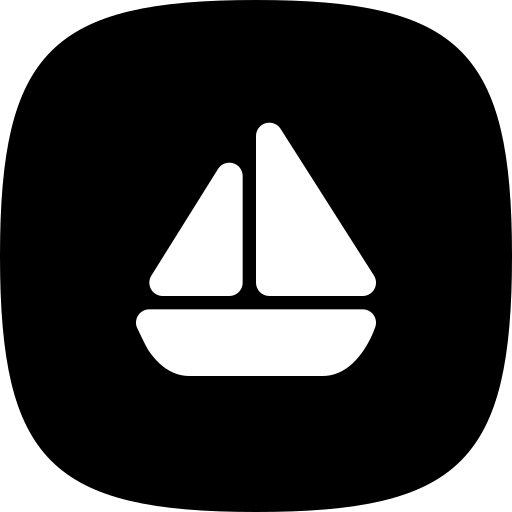

<p align="center">
  
</p>

# Porthmos

[](https://github.com/Smyrnis/porthmos/actions/workflows/ci.yml)
[](https://github.com/Smyrnis/porthmos/releases/latest)
[](LICENSE)

A dual-panel file manager, as a terminal app and as a window app: local files
in one panel, a remote connection in the other, with saved connection
profiles, background transfers, search, folder sync and in-place editing. It
talks SFTP, SCP, FTP and FTPS, WebDAV and S3-compatible storage.

## Highlights

- Dual-panel browser with several connections open at once
- SFTP, SCP, FTP/FTPS, WebDAV and S3-compatible storage
- Background transfers that queue, run in parallel and resume
- Folder sync, remote editing in your own editor, search and a command palette
- Go to a typed path, and optionally reopen the connections you had open last time

<!-- TODO: screenshot / GIF (assets/screenshots/) -->

See [all features](documentation/general/features.md).

## Quick install

```sh
curl -fsSL https://github.com/Smyrnis/porthmos/releases/download/tui-stable/install.sh | sh
```

This installs the terminal app, `porthmos`. For the window app, the preview
channel or building from source, see
[Installing and uninstalling](documentation/general/installation.md).

## Documentation

| Page | What it covers |
| --- | --- |
| [Features](documentation/general/features.md) | What Porthmos can do |
| [Installing and uninstalling](documentation/general/installation.md) | Install scripts, building from source, removal |
| [Keybindings](documentation/general/keybindings.md) | Default keys for every screen |
| [Configuration](documentation/general/configuration.md) | Where settings, connections and state live |
| [Updates and release channels](documentation/general/updates.md) | Background updates, stable and preview channels |
| [Project layout](documentation/general/project-layout.md) | The Cargo workspace and its crates |

## License

MIT — see [LICENSE](LICENSE).
